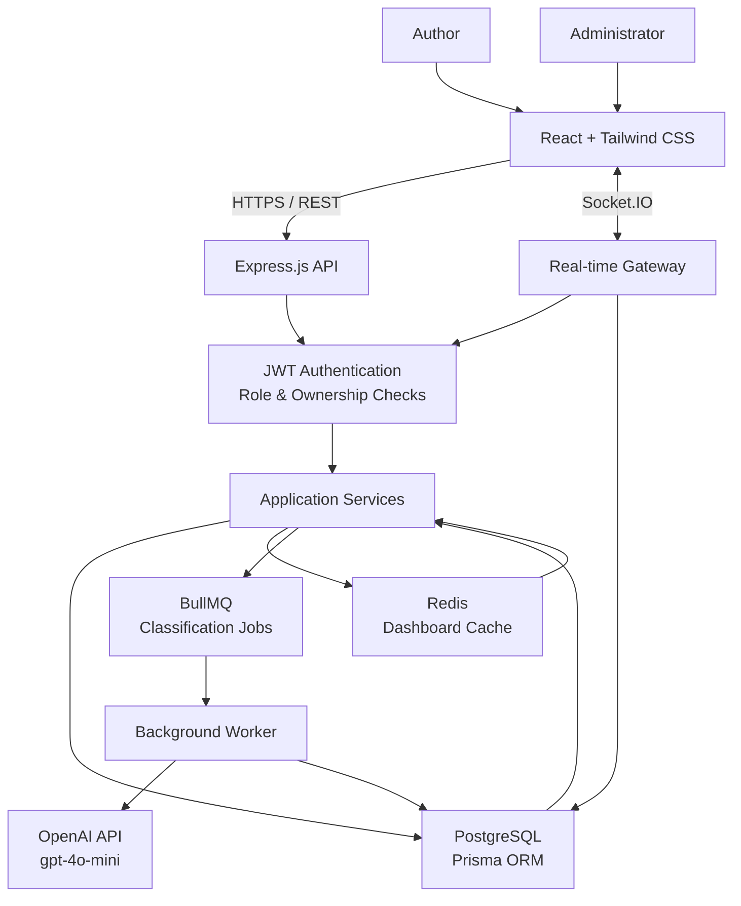
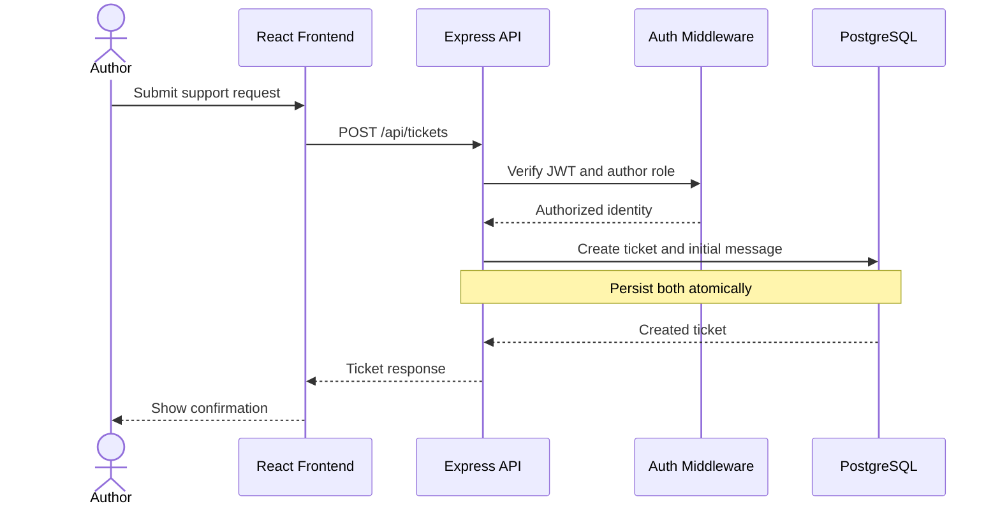
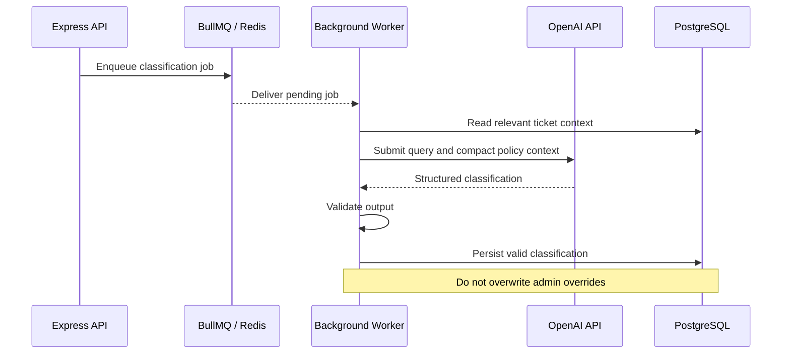
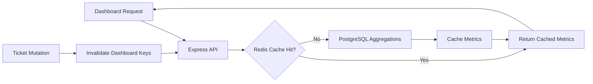
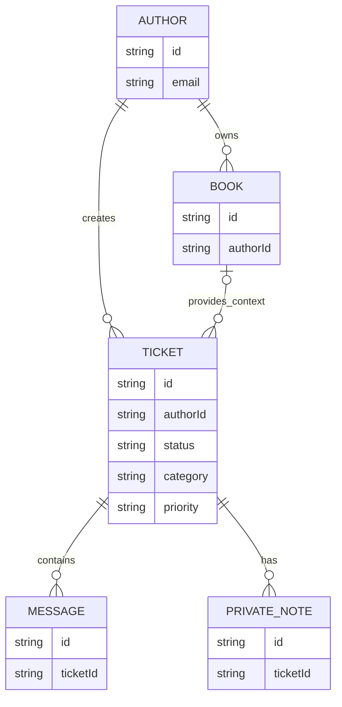

[# BookLeaf — Author Support Portal

**A real-time, AI-assisted support platform for authors and support administrators.**

BookLeaf is a full-stack author support workspace designed to streamline support requests, manage book-related issues, and help administrators respond faster with AI-assisted, policy-grounded drafts.

Built with **React, TypeScript, Express.js, PostgreSQL, Prisma, Redis, BullMQ, and Socket.IO**, the project demonstrates role-based access control, transactional data handling, asynchronous job processing, caching, and real-time communication in a Turborepo monorepo.

<!-- Add a screenshot or GIF of the application here -->

## Table of Contents

- [Overview](#overview)
- [Key Features](#key-features)
- [System Architecture](#system-architecture)
- [Core Workflows](#core-workflows)
- [Database Design](#database-design)
- [AI-Assisted Support](#ai-assisted-support)
- [API Reference](#api-reference)
- [Security and Reliability](#security-and-reliability)
- [Scalability and Design Decisions](#scalability-and-design-decisions)
- [Technology Stack](#technology-stack)
- [Getting Started](#getting-started)
- [Demo Credentials](#demo-credentials)
- [Environment Variables](#environment-variables)
- [Testing and Validation](#testing-and-validation)
- [Limitations and Future Improvements](#limitations-and-future-improvements)

## Overview

Author support involves multiple workflows, including resolving royalty questions, fixing ISBN issues, addressing printing problems, and handling distribution requests. Without a centralized system, managing these requests and maintaining consistent responses can become difficult.

BookLeaf brings these workflows into a single platform.

- **Authors** can access their books, submit support tickets, track ticket status, and communicate with support administrators.
- **Administrators** can manage tickets, assign priorities and categories, add private notes, and generate editable AI-assisted response drafts.
- **The backend** coordinates persistent storage, authorization, caching, background AI processing, and real-time updates.

The system is designed around a key principle: **PostgreSQL is the source of truth, AI assists the workflow rather than controlling it, and authorization is enforced on the server.**

## Key Features

### Author workspace
- Create support tickets with an initial message.
- View and search tickets using filters and pagination.
- Track ticket status, category, and priority.
- Access book-related support context.
- View ticket conversations with real-time communication support.

### Administrator workspace
- Review and manage author support requests.
- Update ticket status, category, and priority.
- Generate AI-assisted response drafts.
- Edit generated drafts before sending a response.
- Add private internal notes.
- View dashboard metrics and administrative overview data.

### Backend and infrastructure
- JWT-based authentication and role-based authorization.
- Author-scoped data access and administrator access controls.
- PostgreSQL persistence with Prisma ORM.
- Redis-backed dashboard caching with mutation invalidation.
- BullMQ jobs for asynchronous AI classification.
- Socket.IO for authenticated, ticket-scoped real-time communication.
- Debounced search with server-side filtering and pagination.
- Seeded demo data for reproducible evaluation.

## System Architecture

The project follows a modular monorepo architecture that separates the frontend, API, database layer, and background processing.

### High-level architecture



*Architecture overview: the frontend communicates with the backend through REST and Socket.IO, while PostgreSQL stores persistent state and Redis supports caching and asynchronous work.*

### Monorepo structure

```text
bookleaf/
├── apps/
│   ├── web/                 # React frontend
│   └── api/                 # Express REST API and backend logic
│       └── prisma/
│           ├── schema.prisma
│           └── data/
│               └── sample.json
├── docs/
│   └── preview.html         # Static UI preview
├── docker-compose.yml
├── pnpm-workspace.yaml
├── turbo.json
├── package.json
└── README.md
```

The exact internal file layout may vary with implementation changes. The repository uses Turborepo and pnpm to coordinate development and build tasks across applications.

### Architectural responsibilities

| Component | Responsibility |
|---|---|
| React + Tailwind CSS | Responsive author and administrator interfaces |
| Express.js | REST endpoints, request validation, and application logic |
| JWT and authorization middleware | Authentication, role checks, and ownership enforcement |
| Prisma ORM | Typed database access and relational queries |
| PostgreSQL | Durable storage and transactional consistency |
| Redis | Short-lived dashboard metric caching |
| BullMQ | Asynchronous AI classification with retries |
| Socket.IO | Real-time communication and authenticated rooms |
| OpenAI API | Context-aware support classification and draft assistance |

## Core Workflows

### 1. Ticket creation and persistence



**Important design decision:** the ticket and its initial message are persisted atomically. This prevents a successfully created ticket from being left without its initial conversation message if the transaction fails.

### 2. AI-assisted classification



Classification is processed asynchronously to keep request handling responsive. BullMQ retries eligible failures using exponential backoff, while output validation prevents malformed model responses from being applied as trusted application data.

### 3. Administrator response workflow

1. An administrator opens a support ticket.
2. The backend verifies the administrator's role and ticket access.
3. The administrator requests an AI-assisted draft.
4. The AI uses the current query and relevant policy context to propose a response.
5. The administrator reviews and edits the draft.
6. The response is sent through the ticket messaging workflow.
7. The persistent backend state remains authoritative for the frontend.

AI-generated content is a suggestion, not an automatically approved customer response.

### 4. Dashboard caching



Dashboard metrics use database-side `count`, `aggregate`, and `groupBy` operations rather than loading all records into application memory. Redis reduces repeated aggregation work, and relevant mutations invalidate cached dashboard keys.

## Database Design

PostgreSQL is the persistent data store, with Prisma providing typed queries and relational access.

### Core entities

The main domain entities include:

- **Author:** author identity and account information.
- **Book:** book metadata associated with author support.
- **Ticket:** support request, lifecycle status, category, priority, and ownership.
- **Message:** conversation entries associated with tickets.
- **Private note:** internal administrator notes that are not intended for authors.

### Relationship overview



*Conceptual domain model; actual field names and optional relationships should be verified against `apps/api/prisma/schema.prisma`.*

### Data integrity and query performance

- Foreign keys maintain relational integrity.
- Ticket creation and initial-message persistence use an atomic transaction.
- Queue and ownership indexes support common lookups.
- Pagination and filtering reduce the volume of records returned to the frontend.
- PostgreSQL performs dashboard aggregations.
- Private notes are handled separately from author-visible conversation messages.

## AI-Assisted Support

BookLeaf integrates `gpt-4o-mini` to assist with support classification and response drafting.

### Context selection

Instead of submitting an entire knowledge base or complete conversation history for every request, the system sends:

- The current support query.
- Compact, relevant policy context.
- Only the information needed for the requested operation.

This approach helps limit unnecessary context, reduce token consumption, and keep model inputs focused.

### Reliability and human oversight

The integration accounts for common failure scenarios:

- Missing API credentials.
- Model timeouts and rate limits.
- Service errors.
- Malformed model responses.

When AI assistance is unavailable, the application falls back to deterministic classification and policy-based editable drafts.

Additional safeguards include:

- Validating model output before use.
- Preserving administrator overrides.
- Requiring administrator review before sending generated drafts.
- Keeping the database as the authoritative source of application state.

**Design principle:** AI augments support operations without replacing application validation or administrator judgment.

## API Reference

All endpoints require `Authorization: Bearer <token>` except the health check and login endpoints.

### Authentication and general endpoints

| Method | Endpoint | Access |
|---|---|---|
| GET | `/api/health` | Public |
| POST | `/api/auth/login` | Public |
| GET | `/api/auth/me` | Authenticated |
| GET | `/api/books` | Authenticated |
| GET | `/api/dashboard` | Authenticated |

### Ticket management

| Method | Endpoint | Access |
|---|---|---|
| GET | `/api/tickets` | Authenticated |
| GET | `/api/tickets/:id` | Ticket owner or admin |
| POST | `/api/tickets` | Author |
| POST | `/api/tickets/:id/draft` | Admin |
| POST | `/api/tickets/:id/messages` | Ticket owner or admin |
| PATCH | `/api/tickets/:id` | Admin |
| POST | `/api/tickets/:id/notes` | Admin |
| GET | `/api/admin/overview` | Admin |

### Ticket filtering

The ticket listing endpoint supports the following query parameters:

| Parameter | Purpose |
|---|---|
| `q` | Search query |
| `status` | Filter by lifecycle status |
| `category` | Filter by support category |
| `priority` | Filter by priority |
| `since` | Filter by date |
| `page` | Page number |
| `take` | Number of records to return |

The frontend debounces search input by 280 ms to reduce unnecessary requests.

### Supported ticket statuses

`OPEN` · `IN_PROGRESS` · `RESOLVED` · `CLOSED`

### Supported categories

`ROYALTY` · `ISBN_ISSUES` · `PRINTING` · `DISTRIBUTION` · `PRODUCTION` · `GENERAL`

### Supported priorities

`CRITICAL` · `HIGH` · `MEDIUM` · `LOW`

## Security and Reliability

Security is enforced at the API and real-time communication layers, rather than relying on frontend visibility controls.

- **JWT authentication:** protected endpoints require a valid bearer token.
- **Role-based access control:** author and administrator capabilities are separated.
- **Ownership enforcement:** author data is scoped to the authenticated token subject.
- **Ticket access checks:** ticket access is validated for REST operations and authenticated Socket.IO rooms.
- **Private notes:** internal notes are kept separate from author-visible messages.
- **Transactional persistence:** related ticket-creation writes are committed atomically.
- **AI output validation:** model responses are validated before being used as application data.
- **Failure handling:** asynchronous classification uses retry policies, and AI failures have fallback behavior.
- **Secret management:** API keys remain on the backend and must not be exposed in frontend code.

REST remains the source of truth. Socket.IO supports live interaction but should not be treated as the durable storage mechanism.

## Scalability and Design Decisions

The project prioritizes correctness and operational simplicity before introducing distributed infrastructure that the current workload does not justify.

| Decision | Rationale |
|---|---|
| PostgreSQL as the primary datastore | Strong relational integrity and transactional writes |
| Redis for short-lived caching | Reduces repeated dashboard aggregation work |
| BullMQ for AI classification | Keeps model calls out of synchronous request processing |
| Socket.IO for live communication | Supports responsive ticket conversations |
| Turborepo monorepo | Keeps frontend and backend development coordinated |
| Database-side aggregation | Avoids fetching entire datasets for dashboard metrics |
| Human-reviewed AI drafts | Preserves control over customer-facing responses |
| Single PostgreSQL writer | Simplifies consistency and operational management |

### Scaling strategy

**Stage 1 — Improve the existing architecture**

- Introduce connection pooling and tune database queries.
- Monitor cache hit rates and optimize invalidation.
- Configure background worker concurrency and queue monitoring.
- Add request rate limiting and operational metrics.
- Load-test pagination, search, and dashboard endpoints.

**Stage 2 — Scale reads and historical data**

- Introduce read replicas where read workloads justify them.
- Partition large ticket or message history tables by time when measurements support it.
- Separate analytical reporting from latency-sensitive transactional workloads.

**Stage 3 — Consider sharding only when necessary**

If a single PostgreSQL deployment becomes a genuine bottleneck, author-scoped ticket and message records could be routed using a stable author-ID hash.

Cross-shard administrative reporting would then require a dedicated aggregation strategy, such as a warehouse or analytical store. Cross-shard transactions and global reporting complexity make sharding a later-stage decision rather than a default choice.

## Technology Stack

| Layer | Technologies |
|---|---|
| Frontend | React, TypeScript, Tailwind CSS |
| Backend | Node.js, Express.js |
| API | REST |
| Database | PostgreSQL |
| ORM | Prisma |
| Cache | Redis |
| Background jobs | BullMQ |
| Real-time communication | Socket.IO |
| AI integration | OpenAI API, `gpt-4o-mini` |
| Monorepo | Turborepo, pnpm |
| Local infrastructure | Docker Compose |
| CI | Install, Prisma generation, lint, and build checks |

## Getting Started

### Prerequisites

Install the following tools:

- Node.js 20 or later.
- pnpm 9 or later.
- Docker Desktop with Docker Compose.

### 1. Clone the repository

```bash
git clone <YOUR_REPOSITORY_URL>
cd <YOUR_REPOSITORY_DIRECTORY>
```

Replace the placeholders with the actual repository URL and directory name.

### 2. Configure environment variables

```bash
cp .env.example .env
```

Populate the variables required by the API, Prisma, Redis, and optional AI integration.

### 3. Start the infrastructure

```bash
docker compose up -d postgres redis
```

This starts the local PostgreSQL and Redis services defined in Docker Compose.

### 4. Install dependencies

```bash
pnpm install
```

### 5. Generate the Prisma client

```bash
pnpm db:generate
```

### 6. Initialize the database

```bash
pnpm db:push
pnpm db:seed
```

These commands synchronize the local database schema and populate the demo dataset. Use the repository's intended migration workflow when working with an existing shared or production database.

### 7. Start the application

```bash
pnpm dev
```

Once the applications are running, open the following URLs:

| Service | URL |
|---|---|
| Web application | [http://localhost:5173](http://localhost:5173) |
| API health check | [http://localhost:4000/api/health](http://localhost:4000/api/health) |

### Troubleshooting

- Verify PostgreSQL and Redis are running before starting the API.
- Check that database and Redis URLs match the local Docker Compose configuration.
- Run Prisma client generation after schema changes.
- Ensure the frontend uses the correct backend URL.
- If AI assistance is unavailable, verify the backend API key and provider configuration; the documented fallback behavior should allow supported workflows to continue.

## Demo Credentials

Use the seeded demo accounts after database initialization.

| Role | Email |
|---|---|
| Author | `priya.sharma@email.com` |
| Administrator | `admin@bookleaf.test` |

**Demo password for both accounts:** `bookleaf-demo`

Seed data is maintained in `apps/api/prisma/data/sample.json`.

These credentials are for local evaluation only. Never use demo credentials in a production deployment.

## Environment Variables

Configure the variables in `.env.example` according to the application's existing environment configuration.

Typical settings include:

| Variable | Purpose |
|---|---|
| `DATABASE_URL` | PostgreSQL connection string |
| `REDIS_URL` | Redis connection string |
| `OPENAI_API_KEY` | Optional backend-only AI integration key |

Additional variables may be required by the frontend or API configuration.

Keep all credentials and secrets out of source control. Never expose `OPENAI_API_KEY` through a frontend environment variable or browser bundle.

## Testing and Validation

The project includes CI checks for dependency installation, Prisma client generation, linting, and application builds.

### Validation status

- Frontend TypeScript lint and production build passed.
- API TypeScript lint and build passed.
- Prisma schema generation was validated in engine-free mode.
- A regular native-engine copy and a live database integration run were blocked by the host environment's disk limit.

**Important:** a successful build does not establish that every database integration or end-to-end workflow has passed. Before a live demonstration, run the database initialization commands in a Docker-enabled environment and verify login, ticket creation, authorization boundaries, messaging, queue processing, and AI fallback behavior.

## Limitations and Future Improvements

The current implementation prioritizes the core support workflow. The following improvements would strengthen production readiness:

- **File attachments:** implement secure object storage, upload validation, and access-controlled downloads. Current attachments are UI-only, as permitted by the assignment.
- **Auditability:** record important administrative actions and ticket changes in an audit trail.
- **Operational monitoring:** add structured logs, metrics, queue failure alerts, and tracing.
- **Authentication hardening:** introduce refresh-token or session revocation where appropriate.
- **Abuse prevention:** add rate limiting, request-size limits, and stricter validation at API boundaries.
- **Notifications:** add email notifications and configurable SLA timers.
- **Production infrastructure:** deploy managed PostgreSQL and Redis, enforce HTTPS, and implement secret rotation.
- **Quality assurance:** add automated API integration tests, authorization tests, queue tests, and an accessibility review.

## Engineering Takeaways

Building BookLeaf involved making practical trade-offs across data consistency, asynchronous processing, AI reliability, and access control.

The architecture emphasizes a few core engineering principles:

1. Keep durable application state in PostgreSQL.
2. Use background jobs for work that does not need to block the request-response cycle.
3. Validate AI-generated data before applying it.
4. Enforce authorization at every relevant server-side boundary.
5. Introduce scaling complexity only when workload measurements justify it.

The result is a modular support platform that combines conventional backend engineering with carefully bounded AI assistance.

---

**Project:** BookLeaf Author Support Portal  
**Architecture:** Full-stack monorepo with REST, real-time communication, caching, and background processing  
**Status:** Core implementation available; production hardening and live integration validation remain follow-up work
**Deploy link:**(https://bookleaf-dnqg-301no6z2c-avichal296s-projects.vercel.app/)
